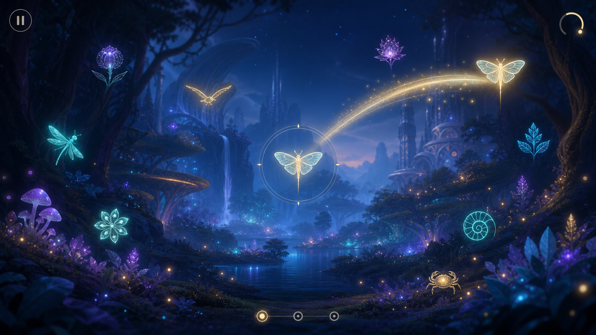
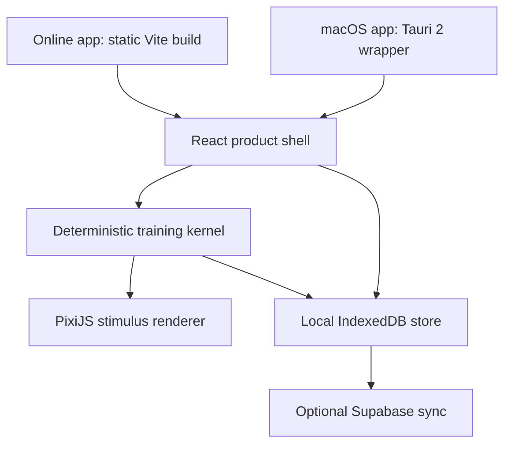

# Lumen product requirements document

| Field | Decision |
|---|---|
| Status | Proposed, requires operator sign-off before build |
| Owner | Chris DiMarco |
| Author | JARVIS |
| Date | 2026-07-13 |
| Product | Consumer visual-attention game for web and macOS |
| Working name | Lumen |
| Product HQ | `~/jarvis/projects/lumen/` |
| Concept art | `assets/lumen-gameplay-concept.png` |



This document authorizes planning only. Building, deployment, Apple signing, paid services, research, and health claims remain blocked until Chris approves the product and scope in section 22.

## 1. Product decision

Build Lumen as a calm, premium visual-attention game. A player identifies a briefly shown central symbol and remembers the location of a peripheral target while the presentation becomes faster and more demanding. The game runs from one shared codebase as an online app and a signed macOS app. It works without an account, stores progress locally, and offers optional cross-device sync.

Lumen is a game, not a medical product. Scores describe performance inside Lumen. The first release must not claim to prevent dementia, improve cognition, measure brain health, or reproduce results from the ACTIVE clinical research.

## 2. Capability

An adult can open Lumen on the web or Mac, understand the interaction in under a minute, complete a satisfying three-minute adaptive session, see honest in-game progress, and return later without losing local data. The same protocol and seed must produce the same trial sequence and difficulty decisions on both platforms.

The product has two separate layers:

- The **training kernel** controls fixation, stimulus selection, positions, timing, masking, responses, scoring, and adaptation.
- The **experience layer** supplies the forest, light, sound, progression, and rewards.

The experience layer may never alter the kernel's timing, obscure targets, resemble a target, cue an answer, or animate during the scored stimulus interval.

## 3. Problem

Existing cognitive-training products often feel clinical, dated, or punitive. Conventional games may look better but do not preserve a controlled visual-processing task. Lumen combines a reproducible perception exercise with the pacing and art direction of a premium consumer game.

The product must solve four problems at once:

1. The first session is understandable without a tutorial wall.
2. Adaptive difficulty remains challenging without making the player feel graded or impaired.
3. Rich scenery never compromises stimulus clarity or timing.
4. Mac and browser differences do not silently corrupt a scored trial.

## 4. Audience

The initial audience is adults 18 and older who enjoy short, calm daily games and want to practice visual attention. The visual language should work especially well for adults 45 and older without presenting itself as an “older-person app.”

V1 is not child-directed. It does not ask about diagnoses, medical history, memory concerns, or cognitive status.

## 5. Product principles

- Start playing before asking for an account.
- Make every interaction legible without making the screen sterile.
- Adapt invisibly. Never label a player slow, impaired, below average, or old.
- Reward consistency and exploration, not compulsive streaks.
- Keep sessions short enough to finish and easy to stop.
- Store the minimum data needed to provide progress and sync.
- Treat protocol changes like code changes: version, test, and document them.
- Prefer one excellent mechanic over a collection of unrelated minigames.

## 6. Non-goals

V1 does not include:

- diagnosis, screening, treatment, health advice, age norms, or a “brain age”;
- claims about dementia, Alzheimer’s disease, memory, intelligence, driving, school, work, reaction time, or everyday function;
- multiplayer, leaderboards, chat, social feeds, ads, loot boxes, virtual currency, or streak penalties;
- subscriptions, payment processing, or an App Store release;
- HealthKit, camera, microphone, contacts, location, medical records, or wearable data;
- a native Swift rewrite, mobile apps, or a general-purpose game engine;
- generative AI in the runtime product;
- research enrollment or reuse of product analytics as research data.

## 7. Core game loop

### 7.1 Standard session

A standard journey lasts about three minutes and contains enough trials to establish a stable in-game score. The final count is determined during the vertical-slice test; start with 24 scored trials plus four unscored practice trials.

Each scored trial follows this state machine:

1. **Settle:** the central reticle rests for 400 to 700 milliseconds with no target-like motion.
2. **Present:** one central glyph and one peripheral target appear simultaneously. Neutral distractors may appear at the same eccentricity. Presentation duration comes from the active protocol.
3. **Mask:** all scored glyphs disappear together. A neutral mask prevents visual persistence.
4. **Identify:** the player selects which of two glyphs appeared in the center.
5. **Locate:** the player selects the remembered peripheral position on an eight-sector response ring.
6. **Resolve:** only after both responses are captured, light travels inward from the chosen position. Correctness is communicated through warmth, sound, and motion without shame or alarm.
7. **Adapt:** the deterministic kernel updates the next trial within protocol bounds.

A trial is correct only when both identity and location are correct. The raw component results remain available to the kernel for tuning.

### 7.2 Controls

- Pointer: click or tap the center choice, then the peripheral sector.
- Keyboard: two labeled keys select the central glyph; arrow or number keys select the peripheral sector; Enter confirms.
- Escape pauses before the next trial. It never pauses halfway through a scored presentation.
- Full keyboard focus and visible focus rings are required in menus and response screens.

### 7.3 Interruptions

A trial is voided and retried when the window loses visibility, resizes, changes display scale, misses the timing tolerance, or records a long frame during the stimulus. Voided trials do not affect score or difficulty. The app explains repeated timing failures in plain language and offers a reduced-effects mode.

## 8. Adaptive protocol

The kernel targets roughly 75 percent complete-trial accuracy. This target is a game-design starting point informed by descriptions of the research task; it does not make Lumen clinically equivalent to that task.

Difficulty may change only through versioned protocol parameters:

- stimulus duration;
- peripheral distance from fixation, expressed as a normalized screen-relative value in V1;
- distractor count;
- target-to-distractor similarity;
- permitted target sectors;
- masking strength;
- response timeout, if enabled.

Use a bounded staircase with small reversible steps. After a run of correct responses, change one dimension by one step. After an error pattern, step back. The exact rule, bounds, and warm-up behavior live in a protocol JSON file and are covered by deterministic tests.

Do not calculate visual angle or make claims about peripheral degrees in V1. Screen size and viewing distance are unknown. A future research mode may add physical calibration, frozen hardware requirements, and a controlled dose.

Every session stores:

- session ID, protocol version, seed, app version, platform, viewport, device-pixel ratio, refresh estimate, and input type;
- intended and measured stimulus onset and duration;
- target identity and positions, response, component accuracy, elapsed response time, difficulty transition, and void reason;
- aggregate session summary.

Raw trial telemetry stays local by default. Optional sync sends the session summary, not raw trials. Export may include raw trials at the user’s request.

## 9. Progression and retention

The launch environment is the **Bioluminescent Forest** shown in the concept art. Completing sessions restores sections of the environment. The reward is visual change, ambient sound, and discovery.

V1 progression includes:

- one forest with four restoration states;
- a three-minute standard journey and an untimed practice mode;
- a seven-session path with no penalty for missed days;
- personal bests for Lumen accuracy, achieved presentation speed, and consistency;
- a simple history view for the last 30 sessions;
- gentle reminders only after explicit opt-in.

Later environments must use the same training kernel. They may replace art and audio but cannot change the scored mechanic without a new protocol version.

## 10. Results language

Allowed labels:

- Lumen accuracy
- presentation speed
- consistency
- journey complete
- personal best
- difficulty adapted to your recent play

Forbidden labels:

- cognitive score
- brain health
- brain age
- dementia risk
- clinical result
- impairment
- normal for your age
- attention disorder

The results screen must say: “These results reflect your performance within Lumen. They are not a medical assessment.”

## 11. User experience

### 11.1 First run

1. Landing screen: “Notice more, a little faster.” It includes the research card specified below. Actions: **Play a journey**, **Read the research**, and **How it works**.
2. Accessibility setup: target size, contrast, motion, sound, and input. Recommended defaults are already selected.
3. Four practice trials with immediate instruction embedded in the scene.
4. Three-minute journey.
5. Results and restored-forest moment.
6. Optional invitation to save progress across devices. “Keep playing on this device” remains equally visible.

The median new user should reach the first practice stimulus within 60 seconds.

#### Opening research card

The first-run landing screen must explain why the game exists without implying that Lumen inherited another product's evidence.

Default collapsed copy:

> **Built from a promising research idea**
>
> Adaptive visual speed training has produced encouraging long-term results in the ACTIVE trial. New biomarker findings are preliminary. Lumen is inspired by this work, but Lumen itself has not been clinically tested.

**Read the research** expands a plain-language panel with this approved draft:

> The ACTIVE research team began studying adaptive visual speed-of-processing training in adults 65 and older in the late 1990s. In 2026, Norma B. Coe and colleagues published a peer-reviewed 20-year follow-up. Participants assigned to speed training who completed booster sessions had a 25 percent lower rate of claims-based dementia diagnosis than the control group. That is encouraging evidence for the specific training regimen, not proof that every brain game works.
>
> At the 2026 Alzheimer's Association International Conference, Hye Won Chai of Clemson University presented a separate 53-person study. It reported a change in a blood beta-amyloid ratio among trained men, but not women. The study was small, the finding needs replication, and the conference result is preliminary.
>
> Lumen is a redesigned consumer game inspired by this line of research. Lumen has not been clinically validated and is not intended to diagnose, treat, cure, or prevent any disease or condition. Your results describe performance inside this game.

The expanded panel links to the peer-reviewed ACTIVE paper, the NIH summary, the AAIC conference page, and a human-readable sources page. It credits Norma B. Coe and the full paper author list on the sources page. It credits Hye Won Chai and her co-authors only after the official conference abstract provides the complete author list.

Before copy freeze, rerun the literature search. Confirm the numbers, author list, publication status, and whether the preliminary biomarker study has been peer-reviewed since AAIC 2026. Update the labels when the evidence changes; never silently promote a conference result into an established finding.

### 11.2 Returning player

The home screen shows the forest, one primary **Continue journey** button, the next restoration milestone, and recent in-game progress. Settings, history, and account stay secondary.

### 11.3 Failure states

- Offline: play continues and saves locally.
- Sync unavailable: queue the update and state that local progress is safe.
- Low frame quality: offer reduced effects and retry the trial.
- Unsupported graphics: explain the browser or Mac requirement; do not show a broken canvas.
- Corrupt local data: preserve a backup, reset only the invalid record, and offer export of diagnostics.

## 12. Design direction

The visual thesis is **naturalist science fiction at blue hour**. The interface should feel crafted for adults: atmospheric, quiet, tactile, and readable.

Palette:

| Token | Value | Use |
|---|---|---|
| Midnight lake | `#101B35` | background depth |
| Storm blue | `#293D62` | panels and distant forms |
| Moon pearl | `#EDF3E8` | primary text and neutral targets |
| Bioluminescent cyan | `#72E4DC` | interactive focus and alternate glyphs |
| Pollen gold | `#FFD778` | correct-resolution light and progress |
| Orchid dusk | `#A58BE8` | secondary flora and atmosphere |

Use a characterful, highly legible display face for chapter names, a humanist sans for product UI, and a tabular utility face for timing and diagnostic views. Font licensing must permit web embedding and app distribution.

The signature response is an inward light ripple from the peripheral match. It starts only after response capture. During scored presentation, ambience freezes or remains below the motion and contrast thresholds defined by the protocol.

## 13. Accessibility and comfort

The app shell must meet WCAG 2.2 AA. The core task is inherently visual and cannot provide a screen-reader-equivalent scored experience; say this honestly in accessibility documentation.

Required controls:

- reduced motion, including removal of the inward ripple;
- high-contrast stimulus layer independent of scenery;
- target scaling without clipping or overlap;
- redundant shape cues so color is never the only differentiator;
- master, music, ambience, and feedback volume;
- keyboard-only play;
- pause between trials;
- photosensitivity-safe effects with no rapid high-contrast flashes;
- a fatigue reminder after two consecutive standard sessions.

Automated checks do not replace keyboard, color-vision, zoom, and motion-sensitivity testing with people.

## 14. Technical architecture

### 14.1 Decision

Use one TypeScript application:

- React and Vite for routes, onboarding, menus, settings, results, and account UI;
- PixiJS 8 with the production WebGL renderer for the gameplay canvas;
- a pure TypeScript deterministic kernel for trials, scoring, and adaptation;
- Tauri 2 as a thin macOS shell around the same static Vite build;
- IndexedDB through Dexie for offline-first local data;
- Supabase Auth and Postgres for optional email-code sign-in and progress sync;
- static web hosting on the operator’s existing Vercel or Cloudflare account;
- GitHub Actions for checks and release artifacts.

React must not control frame-critical stimulus state. Do not use React renders or `setTimeout` for presentation timing. The renderer consumes immutable trial snapshots and never chooses targets, advances protocol state, scores responses, or changes trial timing.

Lumen uses three clocks:

- The **protocol clock** uses monotonic `performance.now()` timestamps for trial state and validity.
- The **simulation clock** advances cosmetic ambience in fixed 16.667-millisecond steps, with an accumulator, at most four catch-up steps, and interpolation for rendering. It discards excess accumulated time after a stall.
- The **audio clock** uses `AudioContext.currentTime` to schedule non-scored cues after user activation.

The fixed simulation step improves ambience consistency; it does not make browser stimulus exposure physically exact. A scored presentation is armed by the kernel, begins on a `requestAnimationFrame` boundary, and ends on the first eligible frame at or after its requested duration. Record requested onset, actual show-frame timestamp, requested duration, actual hide-frame timestamp, measured exposure, refresh estimate, and invalidation reason.

Estimate refresh interval from a rolling median of clean animation-frame deltas gathered outside scored presentation. Do not assume a 60 Hz display. A trial is valid only when visibility and display geometry remain stable, no frame is skipped during the scored interval, and exposure error stays within one estimated refresh interval. Otherwise void the trial without adapting difficulty.

Ambient animation enters its quiet state before stimulus onset and resumes after masking. Renderer resize, quality changes, asset decoding, texture upload, resource cleanup, IndexedDB work, and audio-graph creation occur only between trials.



### 14.2 Rendering system

#### Scene contract

Pixi uses one WebGL context and six ordered scene layers:

1. **Backdrop:** precomposed sky, terrain, water, and distant-forest plates.
2. **Ambient world:** restrained parallax, flora motion, fireflies, and low-cost painterly lighting.
3. **Stimulus isolation:** a protocol-controlled quieting veil that lowers environmental contrast before a scored presentation.
4. **Scored stimuli:** fixation, central glyph, peripheral target, distractors, and mask. This layer uses dedicated textures and receives no filters, particles, parallax, color grading, or inherited animation.
5. **Response:** identity choices, sector ring, keyboard focus, and pointer hit regions.
6. **Resolution:** inward ripple, warmth, particles, restoration, and reward animation. It remains disabled until both responses are captured.

React owns menus and document UI outside the frame-critical canvas. Pixi owns the gameplay surface. DOM overlays may not cover or reflow the scored arena.

Keep the scene graph shallow. The root is already a Pixi render group. Add at most one explicit render group for the independently changing stimulus and response subtree, and only when profiling proves a benefit. Do not create one render group per layer.

The renderer may interpolate cosmetic motion between simulation states. Cosmetic randomness uses a separate seeded generator and never consumes protocol randomness.

#### Responsive arena

Author art in a 1600 × 900 logical world. At runtime, compute a centered stimulus arena inside the available canvas with contain-fit scaling. Letterbox or extend scenery outside the arena; never stretch it.

Protocol coordinates are normalized to the stimulus arena, not the browser viewport or background art. Peripheral distance is derived from the arena’s shorter dimension. A minimum edge inset and central exclusion radius prevent clipping and overlap at every supported aspect ratio.

Maintain explicit transforms between normalized protocol space, logical world space, canvas CSS pixels, and renderer pixels. Convert pointer input through the inverse arena transform before hit testing.

Renderer resolution is `min(devicePixelRatio, qualityTierCap)`. Sample device-pixel ratio, canvas size, safe area, browser zoom, and display migration between trials. Any change during presentation voids the trial. A resolution change never changes protocol coordinates.

#### Asset pipeline

Keep authored source art separate from runtime assets. A deterministic AssetPack build creates hashed manifests and lifecycle bundles:

- `core`: fixation, glyphs, masks, response controls, and minimal fallback art;
- `forest-base`: the launch environment;
- `forest-restoration-1` through `forest-restoration-4`;
- `effects-high`, `effects-medium`, and `audio`.

The `core` bundle loads first and remains resident. Environment and effect bundles load lazily and may be unloaded at route boundaries. Use Pixi’s background bundle loading after the first playable state.

Pack small scenery and effect sprites into lifecycle-specific atlases, normally no larger than 2048 × 2048. Do not combine core stimuli, environments, and restoration states in one atlas. Avoid large transparent gutters and atlas rotation for directional stimulus assets.

Runtime formats:

- KTX2/Basis ETC1S for large opaque or softly textured scenery after profiling confirms value;
- KTX2/Basis UASTC where alpha-edge fidelity matters;
- WebP or PNG fallback selected through the Pixi manifest;
- lossless stimulus and mask assets;
- WOFF2 for UI fonts;
- compressed audio with a tested platform fallback.

Compressed textures belong in the art-polish phase, not phase 0. Import only the Pixi loaders used by the build.

Loading an image does not guarantee GPU residency. Import Pixi’s Prepare plugin and upload all required trial textures and graphics before opening the journey-ready gate. Precompile any approved custom filter during the loading state. Never create textures, graphics geometry, filters, fonts, or text objects inside a scored trial.

Cache and reuse runtime-generated textures. Release environment bundles through the shared asset system; do not destroy a texture still owned by the Pixi cache. Explicitly destroy only application-owned render textures and generated resources when their scene is disposed.

#### Lighting, effects, and motion

Lumen uses painterly 2D lighting, not a deferred lighting engine:

- pre-baked emissive flora in environment plates;
- a small set of additive glow sprites;
- one optional reduced-resolution light buffer outside scored presentation;
- no more than one full-scene color treatment;
- pre-baked bloom sprites or one bounded post-response filter.

Do not continuously animate full-screen blur, displacement, noise, masks, gradients, or multi-pass bloom. Full-screen filters are disabled from settle through mask. Filter bounds must be explicit and no larger than the affected region. Use transforms and opacity for DOM motion; never interleave layout reads and writes in one frame.

Prefer pooled ordinary sprites for the launch particle counts. Adopt Pixi’s experimental `ParticleContainer` only if profiling proves that pooled sprites miss the budget. If used, declare only required properties dynamic and supply explicit bounds.

Every effect has a reduced-motion version and a zero-effect fallback. The inward light ripple is the one dominant response effect. It should be a bounded mesh or pre-baked texture sequence, not a full-screen shader stack.

#### Audio and visual synchronization

Create the Web Audio graph after a user gesture. Keep separate music, ambience, and feedback buses.

Scored presentation contains no target-correlated, directional, or correctness-predicting sound. Duck salient ambience before presentation. Schedule post-response feedback on the audio clock and start the ripple on the animation frame nearest the cue. Audio and visual onset should remain within 50 milliseconds on supported hardware. If audio is suspended, continue visually without delaying the game.

#### Context-loss recovery

Listen for `webglcontextlost` and `webglcontextrestored`. On loss:

1. Void the active trial immediately.
2. Stop the renderer and pause before the next trial.
3. Show a DOM recovery message that does not depend on WebGL.
4. Restore or recreate the renderer, reload the manifest, and prepare the core bundle.
5. Resume from the last safe inter-trial checkpoint.

After two losses in one journey, restart in Low quality. If recovery still fails, preserve progress and offer diagnostics export instead of looping.

### 14.3 Repository shape

Use one package, not a monorepo:

```text
lumen/
├── src/
│   ├── app/                 # React shell and routes
│   ├── game/
│   │   ├── core/            # pure state machine and protocol
│   │   ├── render/
│   │   │   ├── layers/      # ordered Pixi scene contract
│   │   │   ├── assets/      # manifests, preparation, disposal
│   │   │   ├── quality/     # tiers and capability selection
│   │   │   └── metrics/     # local frame and resource diagnostics
│   │   └── protocols/       # versioned JSON contracts
│   ├── data/                # local schema, migrations, sync queue
│   ├── platform/            # web and Tauri adapters
│   └── styles/              # tokens and app-shell styles
├── src-tauri/               # thin Rust shell and bundle config
├── supabase/                # migrations, RLS policies, functions
├── e2e/
├── public/
├── docs/
├── PRD.md
└── README.md
```

Keep Rust limited to Tauri configuration and required plugins unless a measured native need appears.

### 14.4 Data model

Local records:

- `profile`: guest ID, preferences, consent versions, created time;
- `settings`: accessibility, audio, reminder, sync, analytics;
- `sessions`: immutable summary plus optional local trial data;
- `progress`: restoration state and unlocks derived from completed sessions;
- `sync_queue`: idempotent pending operations;
- `schema_meta`: data and protocol migration versions.

Cloud tables after sync ships:

- `profiles(user_id, created_at, locale)`;
- `settings(user_id, payload, updated_at)`;
- `sessions(id, user_id, protocol_version, summary, completed_at, app_version)`;
- `consents(id, user_id, kind, version, granted_at, withdrawn_at)`;
- optional `protocol_assignments(user_id, protocol_version)` for controlled rollout.

All exposed cloud tables require row-level security. A user may access only rows matching `auth.uid()`. Session UUIDs are client-generated; sync uses idempotent upsert. Sessions are immutable. Settings use last-write-wins with an explicit timestamp.

### 14.5 Authentication

Guest play is the default. Optional sync uses email one-time codes, avoiding deep-link differences between browser and Tauri. Do not use anonymous cloud accounts. Account linking imports local progress only after explicit confirmation.

## 15. Privacy, security, and claims

The first release is local-first and account-optional.

Requirements:

- no ad SDKs, data brokers, targeted advertising, or sale of gameplay data;
- separate consent for account processing, optional product analytics, marketing, and any future research;
- analytics off until the player makes an informed choice;
- no raw trial telemetry in third-party analytics;
- encryption in transit and managed encryption at rest for synced data;
- least-privilege service keys, secrets outside source control, strict content security policy, dependency scanning, and rate limits on auth and sync;
- tested account export, account deletion, consent withdrawal, and deletion propagation;
- matching privacy behavior and disclosures on web and Mac;
- no remote code execution or downloaded executable content;
- a legal and privacy review before public launch.

If research inspiration is discussed, use this disclosure without weakening it through surrounding copy:

> Lumen is inspired by visual speed-of-processing tasks studied in older adults. Lumen itself has not been clinically validated and is not intended to diagnose, treat, cure, or prevent any disease or condition. Results reflect performance within the game and are not a medical assessment.

Do not call Lumen “the ACTIVE intervention,” “Double Decision,” “clinically equivalent,” or “the game shown to reduce dementia risk.” Review trademark, copyright, patent, and licensing risk before release.

## 16. Analytics and success measures

Collect first-party operational events only after consent:

- onboarding completed;
- session started, completed, or abandoned;
- session duration and protocol version;
- reduced-effects fallback triggered;
- sync succeeded or failed;
- account export or deletion completed.

No event contains a health conclusion, raw responses, target positions, email, or free text.

MVP product targets:

| Measure | Target |
|---|---|
| New user reaches first practice trial | 60 seconds or less, median |
| Standard journey completion | 75 percent or higher during usability test |
| Crash-free sessions | 99.5 percent or higher |
| Scored trials with valid timing | 99 percent or higher on supported devices |
| Returning players who complete a second journey | Measure during beta; no invented target before baseline |
| Account requirement | Zero for local play |
| Cross-platform seeded parity | 100 percent in automated fixtures |

## 17. Performance and compatibility

Initial support:

- macOS 13 or later on Apple Silicon and Intel;
- current and previous major versions of Safari, Chrome, and Edge on desktop;
- landscape layouts down to 1024 × 700 for scored play;
- smaller screens may access account, history, and settings but should direct the player to a supported display for scored play.

Production uses WebGL. Pixi currently recommends WebGL for production while WebGPU behavior continues to vary across browsers. WebGPU is not a V1 release target.

### 17.1 Quality tiers

Ship three tested graphics tiers:

| Feature | High | Medium | Low |
|---|---:|---:|---:|
| Resolution cap | 2.0 DPR | 1.5 DPR | 1.0 DPR |
| Animated parallax layers | 3 | 2 | 0–1 |
| Ambient particles | 300 | 120 | 0–40 |
| Optional light buffer | 1/2 resolution | 1/4 resolution | disabled or pre-baked |
| Post-response bloom | bounded | simplified | disabled |
| Restoration animation | full | shortened | static dissolve or crossfade |

Select the initial tier from renderer-creation success, maximum texture size, supported compressed formats, reduced-motion preference, and a short unscored warm-up measurement. Do not depend on browser identity or `navigator.deviceMemory` alone.

Automatic downgrade requires sustained evidence: three missed-frame windows within one journey or repeated trial invalidation attributable to frame quality. Downgrade only between trials, persist it for the journey, and explain the change only if it affects play. Automatic upgrade happens only on a later launch or through settings.

`prefers-reduced-motion` overrides cosmetic features but never lowers stimulus contrast or target size.

### 17.2 Runtime budgets

Measure menu, ambience, scored presentation, and post-response effects separately.

On the baseline M1 Mac at 1440 × 900:

- sustain the display refresh target, normally 60 Hz, with no thermal-growth regression during a 20-minute soak;
- ambience frame time p95 at or below 18 milliseconds and p99 at or below 25 milliseconds;
- main-thread game update p95 at or below 2 milliseconds;
- renderer CPU submission p95 at or below 6 milliseconds;
- no asset decode, texture upload, shader compilation, font construction, IndexedDB work, or resource cleanup from settle through mask;
- no long task above 50 milliseconds from settle through mask;
- at least 99 percent valid scored trials across the supported matrix;
- no more than one automatic quality downgrade per journey;
- no monotonic heap or GPU-texture growth across ten consecutive journeys.

Transfer and graphics-memory budgets:

- first playable transfer at or below 5 MB compressed;
- complete launch-forest transfer at or below 20 MB compressed, excluding optional audio, unless measured visual benefit earns an exception;
- estimated resident GPU textures at or below 128 MB on High, 80 MB on Medium, and 48 MB on Low;
- no single runtime texture above 4096 × 4096, with 2048 × 2048 the default atlas limit;
- no more than 40 draw calls during Medium-tier ambience and 24 from settle through mask, unless a captured profile justifies an exception.

Track texture cost as decoded GPU size, not download size. A 2048 × 2048 uncompressed RGBA texture is roughly 16 MB before mipmaps and roughly 21 MB with a complete mip chain.

### 17.3 Diagnostics

A development-only overlay records refresh estimate, frame-time histogram, update and render durations, renderer type, resolution, quality tier, draw calls, rendered-object count, texture count, estimated texture bytes, invalidation reasons, context losses, and quality transitions.

Diagnostics stay local unless the player explicitly exports them. Production analytics receives only aggregate operational events already allowed in section 16.

## 18. Verification

The build is incomplete until all applicable checks pass.

### Kernel

- Vitest fixtures prove identical seed plus protocol yields identical trials and transitions.
- Property tests prove targets stay in bounds, never overlap prohibited zones, use permitted sectors, and remain within protocol limits.
- Tests cover warm-up, ceiling, floor, error recovery, pause, interruption, serialization, and migrations.
- A fake monotonic clock tests timing without sleeping.

### Product shell and data

- React Testing Library covers onboarding, settings, results language, consent, and error states.
- Database tests prove one user cannot read or alter another user’s rows.
- Offline-to-online tests prove a session syncs exactly once after reconnect.
- Export and deletion are verified against local and cloud stores.

### End-to-end

- Playwright covers first run through results in Chromium and WebKit.
- Deterministic visual-test mode uses separate fixed protocol and cosmetic seeds, a frozen scene clock, fixed viewport and DPR 1, a pinned quality tier and asset-manifest version, local fonts, and no time-, locale-, network-, or device-dependent decoration.
- Pixel-golden tests run in one pinned Chromium software-renderer environment. Cross-browser checks assert layout bounds, stimulus identity and position, sampled colors, and tolerant perceptual screenshots instead of demanding pixel equality from different GPUs.
- Golden coverage includes every trial state, every restoration state, reduced motion, high contrast, all quality tiers, and loading, recovery, and error states.
- A built Tauri app smoke test covers launch, a complete offline session, persistence after restart, and updater rejection of an invalid signature.
- CI triggers `WEBGL_lose_context` and verifies trial invalidation, DOM fallback, renderer restoration, texture re-upload, checkpoint recovery, and the repeated-loss Low-tier fallback.
- Real-Mac checks use the packaged app, not only the development server.
- Keyboard, 200 percent zoom, reduced motion, color-vision cues, offline mode, and low-frame fallback receive manual checks.

### Release

- typecheck, lint, unit, integration, E2E, dependency audit, secret scan, and production builds pass in CI;
- the web build deploys to a preview URL and passes a fresh-browser smoke test;
- the signed and notarized DMG opens on a clean supported Mac without a Gatekeeper warning;
- Apple credentials and updater signing keys exist only in protected CI secrets;
- privacy policy, data inventory, App Store-style privacy disclosures, and claims review match the shipped build.

## 19. Delivery plan

| Phase | Deliverable | Exit gate |
|---|---|---|
| 0. Protocol and vertical slice | Signed trial contract, separate protocol/cosmetic seeds, three-clock timing harness, logical arena transforms, one plain stimulus set, one forest frame, Low-tier fallback, context-loss path | Safari and Tauri produce matching seeded trials; 60 Hz and high-refresh timing fixtures pass; core textures are prepared before play; context-loss recovery passes |
| 1. Local web MVP | Guest onboarding, practice, three-minute sessions, results, settings, history, IndexedDB | Complete offline loop passes E2E; first-play and performance targets met |
| 2. macOS beta | Thin Tauri shell, native window/menu, persistence parity, signed/notarized beta DMG | Clean-Mac install and full-session smoke pass |
| 3. Optional account sync | Email code, RLS schema, sync queue, consent, export/delete | Cross-device history syncs exactly once; tenant-isolation tests pass |
| 4. Art and audio polish | AssetPack manifest pipeline, compressed-texture fallbacks, four forest restoration states, final audio, all quality tiers | Visual review confirms no stimulus interference; KTX2 fallback matrix passes; ten-journey memory soak and tier-by-tier visual, filter, draw-call, texture, motion, and photosensitivity reviews pass |
| 5. Public release | Production web deploy, notarized Mac DMG, updater, support/privacy pages | Full matrix, security review, claims review, and release checklist pass |

Mac App Store distribution is a later track. Direct signed/notarized DMG distribution ships first. App Store sandboxing, provisioning, receipts, and review add cost without validating the game.

## 20. AI builder contract

The implementing AI must:

1. Treat this PRD as the product source of truth. Record approved deviations in `docs/decisions/` before coding them.
2. Start with phase 0. Do not build accounts, cloud sync, multiple environments, or release automation before the kernel and timing gates pass.
3. Compile a task-specific coding brief for each phase with success condition, files, commands, risk tier, tests, and stop condition.
4. Use test-driven development for the kernel, persistence, sync, and claims-language guards.
5. Keep the game core pure and independent of React, Pixi, Tauri, Supabase, and wall-clock APIs.
6. Keep the experience layer out of scored timing. Effects begin after response capture.
7. Stop if a required product decision changes the protocol, data collection, regulatory position, or external spend.
8. Produce evidence for every exit gate: command output, built artifact, screenshot, and a short receipt.
9. Never publish, buy services, create paid accounts, submit to Apple, or make health claims without explicit operator approval.
10. Do not build a custom entity-component system, scene editor, deferred lighting engine, dynamic shadows, procedural environment generator, custom audio engine, WebGPU parity layer, or OffscreenCanvas worker path without a measured failure that the simpler design cannot fix.
11. Do not change renderer resolution, quality tier, scene geometry, asset residency, or effect configuration during a scored trial.

Definition of done: the production URL and notarized DMG deliver the same tested game loop; guest play works offline; optional sync is private and correct; the visual layer meets the approved art direction; and no product surface implies an unsubstantiated health outcome.

## 21. Research path after product validation

Research is a separate program, not an MVP feature.

1. **Technical validation:** freeze a protocol and verify timing, placement, input latency, and parity on a restricted device matrix.
2. **Usability and safety:** test comprehension, fatigue, frustration, motion sensitivity, accessibility, and adherence with the intended age range.
3. **Mechanism study:** run a preregistered randomized trial of the exact Lumen build and dose against a credible active control. Define the primary outcome in advance and use independent validated measures.
4. **Far-transfer study:** separately test any proposed claim about daily attention, driving, work, or quality of life.
5. **Clinical-outcome study:** any dementia or MCI claim requires a much larger and longer Lumen-specific study with clinically meaningful outcomes.

Health-related research requires independent ethics review, separate research consent, preregistration, a statistical analysis plan, adverse-event monitoring, and publication of positive, negative, and null results. Product analytics cannot quietly become research data.

No health or real-world performance claim ships unless the exact build and dose were tested in the intended population, the study directly measured the advertised outcome, independent scientific and legal reviewers support the exact wording, and the regulatory and privacy analysis has been repeated.

## 22. Operator sign-off

Recommended decisions:

1. Approve **Lumen** as a working name, subject to trademark and domain checks before release.
2. Approve the shared React/Vite/PixiJS/Tauri architecture.
3. Approve a local-first guest MVP with optional Supabase sync in phase 3.
4. Approve an 18+ consumer game position with no health claims.
5. Approve direct notarized Mac distribution before the Mac App Store.
6. Approve the Bioluminescent Forest as the only launch environment until phase 0 and phase 1 pass.

Build status remains **BLOCKED: needs operator sign-off on these six decisions**. A single “approved” authorizes phase 0 only. Later phases advance through their exit gates; deployment, paid spend, Apple submission, and research still require separate approval.

## 23. Sources

Scientific and claims boundary:

- [NIH: cognitive speed training over weeks may delay dementia diagnosis over decades](https://www.nih.gov/news-events/news-releases/cognitive-speed-training-over-weeks-may-delay-diagnosis-dementia-over-decades)
- [Coe et al. 2026, ACTIVE 20-year follow-up](https://doi.org/10.1002/trc2.70197)
- [PubMed record for Coe et al. 2026](https://pubmed.ncbi.nlm.nih.gov/41669119/)
- [UAB summary of the ACTIVE task and updated exercise](https://www.uab.edu/news/research-innovation/study-shows-brain-training-can-reduce-alzheimers-and-dementia-risk-by-25-percent)
- [Alzheimer's Association International Conference 2026](https://aaic.alz.org/)
- [New Scientist report on Hye Won Chai's preliminary AAIC biomarker presentation](https://www.newscientist.com/article/2578806-game-that-reduces-dementia-risk-clears-amyloid-from-mens-brains/)
- [FTC Health Products Compliance Guidance](https://www.ftc.gov/business-guidance/resources/health-products-compliance-guidance)
- [FTC Lumosity settlement](https://www.ftc.gov/news-events/news/press-releases/2016/01/lumosity-pay-2-million-settle-ftc-deceptive-advertising-charges-its-brain-training-program)
- [FDA General Wellness policy, January 2026](https://www.fda.gov/regulatory-information/search-fda-guidance-documents/general-wellness-policy-low-risk-devices)
- [Apple App Review Guidelines](https://developer.apple.com/app-store/review/guidelines/)
- [Apple App Privacy](https://developer.apple.com/help/app-store-connect/manage-app-information/manage-app-privacy)

Implementation:

- [Tauri frontend configuration](https://v2.tauri.app/start/frontend/)
- [Tauri distribution](https://v2.tauri.app/distribute/)
- [Tauri macOS application bundles](https://v2.tauri.app/distribute/macos-application-bundle/)
- [Tauri updater](https://v2.tauri.app/plugin/updater/)
- [PixiJS renderers](https://pixijs.com/8.x/guides/components/renderers)
- [PixiJS render loop](https://pixijs.com/8.x/guides/concepts/render-loop)
- [PixiJS render groups](https://pixijs.com/8.x/guides/concepts/render-groups)
- [PixiJS asset manifests and bundles](https://pixijs.com/8.x/guides/components/assets/manifest)
- [PixiJS background asset loading](https://pixijs.com/8.x/guides/components/assets/background-loader)
- [PixiJS compressed textures](https://pixijs.com/8.x/guides/components/assets/compressed-textures)
- [PixiJS texture preparation and lifecycle](https://pixijs.com/8.x/guides/components/textures)
- [PixiJS particle container](https://pixijs.com/8.x/guides/components/scene-objects/particle-container)
- [MDN WebGL best practices](https://developer.mozilla.org/en-US/docs/Web/API/WebGL_API/WebGL_best_practices)
- [MDN `WEBGL_lose_context`](https://developer.mozilla.org/en-US/docs/Web/API/WEBGL_lose_context)
- [PixiJS accessibility](https://pixijs.com/8.x/guides/components/accessibility)
- [Supabase Row Level Security](https://supabase.com/docs/guides/database/postgres/row-level-security)
